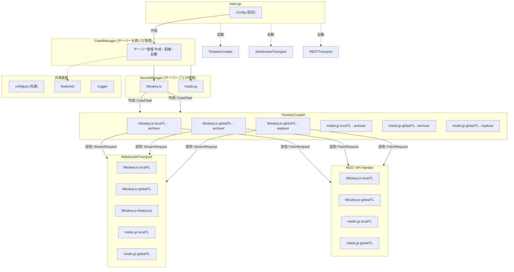

# System Architecture

## コンポーネント構成&制御フロー

- 主要コンポーネントを **Goチャネルだけで疎結合に接続** する。
- Misskeyの特定Noteのキャプチャリングに関しては，Archiverのログの中に一緒に混ぜ込んでしまう（StreamRequestのtlにnote:xxxxxを入れたものをchanは同じのままでもう一つ投げる）方法を取る予定。Note毎にArchiverは作らない


``` go
type CrawlTask struct {
    domain string,  // ex. misskey.io
    system string,  // ex. misskey
    role string,    // Archiver or Explorer
    tl  string,     // global or local
    since string,   // Note ID xxxxxx or oldest
    until string,   // Note ID xxxxxx or up-to-date
    newserver chan<- server // Explorerで発見されたサーバーを通知するチャンネル
}

// 完全に分離されていて，WSHandlerの共通エンドポイントに対して，以下の構造体を投げつけたら，msg chanにメッセージを流してほしい
type StreamRequest struct {
    domain string,  // ex. misskey.io
//    system string,  // ex. misskey    インターフェースを合わせる形で呼び出す関数自体をsystem毎に分けるのもあり　ex. ↓
    tl string,      // global or local or "note: xxxxx"
    msg chan<- message, // received message channel (channelはCHHandlerごとに1つもつ)
}

// ページングで取得した結果をmsg chanにメッセージを流してほしい
type FetchRequest struct {
    domain string,  // 同上
//    system string,
    tl string,
    msg chan<- message,
    since string,   // Note ID xxxxxx or oldest
    until string,   // Note ID xxxxxx
}

// StreamRequest(旧WebSocketHandler)呼び出し例
// プラットフォーム別の実装 (中身は違う、呼び方は同じ)
type MisskeyWSHandler struct { ... }   // 共有WS + connectメッセージ
type MastodonWSHandler struct { ... }  // TL別エンドポイントに個別WS
type NostrWSHandler struct { ... }     // 共有WS + REQメッセージ
// ファクトリで切り替え
func NewWSHandler(system string) WSHandler {
    switch system {
    case "misskey":  return &MisskeyWSHandler{}
    case "mastodon": return &MastodonWSHandler{}
    case "nostr":    return &NostrWSHandler{}
    }
}
//////////////////////////
```


### 各コンポーネントの責務

| コンポーネント | 責務 | 知ること | 知らないこと |
|---|---|---|---|
| **main.go** | CLI引数のパース, 設定の保持，各コンポーネントの起動，管理 | フラグ定義 |  |
| **CrawlManager** | 発見した新規サーバーに対してServerManagerを作成 | | 各サーバーへの接続詳細 |
| **ServerManager** | Archiver, Explorerの起動のみ | サーバー種別，対象TL | メッセージの中身 |
| **TimelineCrawler** | データ取得手段(WS or REST)の選択，パース・URL抽出・キューイング | メッセージフォーマット，サーバードメイン，接続方法 | 具体的なエンドポイント |
| **WebSocketTransport** | WebSocketの接続，受信，再接続，チャネルへの転送 | エンドポイント, chan | メッセージの使途 |
| **RESTTransport** | RESTAPI呼び出し，ページング，チャネルへの転送 | エンドポイント, chan，since, until | メッセージの使途 |
| **Writer** | RawMessageの永続化 | ファイル形式 (json/cbor) | メッセージの生成元 |
| **MediaDownloader** | メディアファイルのDL・保存 | HTTP, ファイルシステム | メッセージの生成元 |
| **NodeInfo** | サーバー情報取得・保存 | NodeInfo仕様 | CrawlManagerの内部 |


## 分離候補の分析

### 1. CrawlManager の責務分割

現在 `manager.go` (479行) が担っている全責務:

| 現在の責務 | 移行先 | 理由 |
|---|---|---|
| サーバー管理 (Registry, KnownServers) | **CrawlManager (残留)** | 本来の責務 |
| Provider作成 (getProvider) | **WebSocketTransport and/or REST API Handler** | 簡素化 |
| 接続・再接続ロジック | **→ WebSocketTransport** | transport層の責務 |
| NodeInfo取得・保存 | **→ nodeinfo パッケージに完全移行** | 既にパッケージは存在 |
| CrawlSession記録 | **→ Writer or 独立モジュール** | 記録はWriterの責務 |
| AppendToFile | **→ 削除** | utils or writer に統合 |

### 2. ReceiveMessages と CrawlNewServer の統合

各プロバイダーで受信ループがほぼ重複している。

```
現在: Archiver用とExplorer用で同じglobal TLに別々のWS接続を張っている

  WSConnection#1 (global) → ReceiveMessages → archive
  WSConnection#2 (global) → CrawlNewServer  → explore
```

```
新設計: 1つのHandlerから複数出力

  WSConnection (global) → TimelineCrawler → chan RawMessage   → Writer
                                         → chan DownloadItem → MediaDownloader
                                         → chan Server       → CrawlManager
```

globalTLのWS接続が **2本 → 1本** に削減。

### 3. urlAdjust() の4箇所重複

同一コードが misskey, mastodon, nostr, bluesky にコピーされている。

→ `utils/url.go` 等に共通関数として1箇所にまとめる。

### 4. main.go の設定管理

`readFlags()` が11個の値をタプルで返している。

```go
// 現在
system, mode, url, serverListPath, timelineStr, downloadDir, 
  verbose, media, media_fetch_only, parallelDownload, scope := readFlags()

// 改善案
type Config struct {
    System           string
    Mode             string
    URL              string
    ServerListPath   string
    Timelines        []string
    DownloadDir      string
    Verbose          bool
    Media            bool
    MediaFetchOnly   bool
    ParallelDownload int
    Scope            string
}
```

### 5. Writer の DataType 分岐

`Writer` が `json` と `cbor` を `switch` で分岐しているが、Bluesky の CBOR 処理は本来 TimelineCrawler で吸収してからWriterに渡すほうが自然。

→ Writer は「RawMessage を書き出す」1つの責務に集中。フォーマット固有の処理は TimelineCrawler 側で。